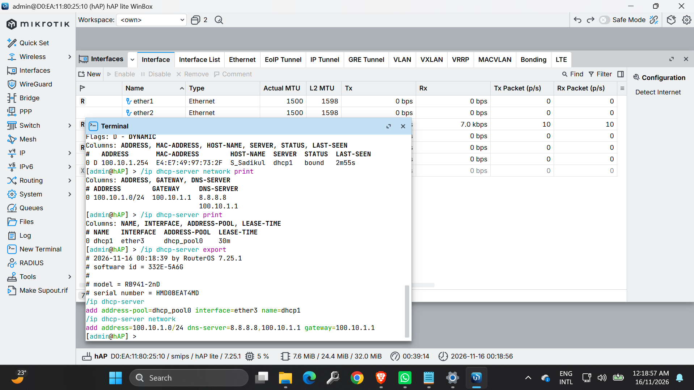
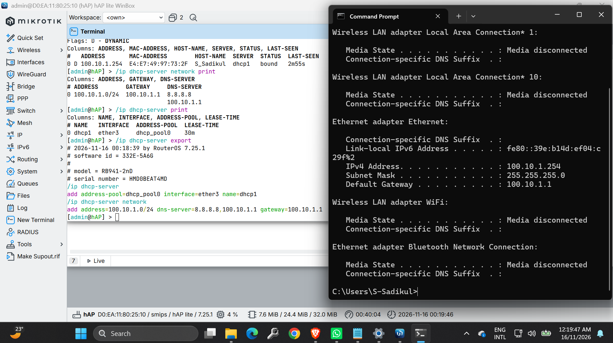
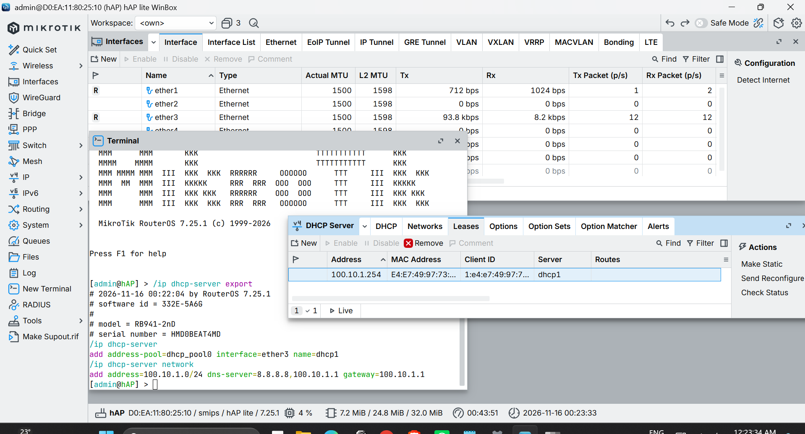

# 🚀 MikroTik RouterOS DHCP Server Configuration & IP Lease Testing

This repository documents a hands-on networking lab configuring a dynamic **DHCP Server** on a **MikroTik hAP lite** router running **RouterOS v7.25.1**, including pool allocation, gateway/DNS distribution, and client-side IP lease verification.

## 📋 Lab Overview

The objective of this lab is to automate IP address assignment for local area network (LAN) devices using MikroTik's built-in DHCP Server and verify successful dynamic IP allocation (`100.10.1.254`) on a connected Windows client.

### 🖥️ Hardware & Software Specifications

* **Router Model:** MikroTik hAP lite (`RB941-2nD`)
* **Operating System:** RouterOS `v7.25.1`
* **Configuration Tools:** WinBox & MikroTik CLI
* **Client OS:** Windows 11 (`S_Sadikul`)

## 🌐 Network & DHCP Parameters

| Parameter | Configuration Value |
| :--- | :--- |
| **DHCP Interface** | `ether3` |
| **DHCP Server Name** | `dhcp1` |
| **Network Address** | `100.10.1.0/24` |
| **Default Gateway** | `100.10.1.1` |
| **DNS Servers** | `8.8.8.8`, `100.10.1.1` |
| **Address Pool** | `dhcp_pool0` |
| **Lease Time** | `30m` (30 minutes) |
| **Assigned Client IP** | `100.10.1.254` (MAC: `E4:E7:49:97:73:2F`) |

## ⚙️ Step-by-Step CLI Configuration

Below are the exact RouterOS CLI commands used to configure and verify the DHCP server:

```routeros
# 1. Assign Gateway IP Address to the LAN Interface (ether3)
/ip address
add address=100.10.1.1/24 interface=ether3 network=100.10.1.0 comment="DHCP LAN Gateway"

# 2. Create IP Address Pool for DHCP Clients
/ip pool
add name=dhcp_pool0 ranges=100.10.1.2-100.10.1.254

# 3. Configure DHCP Network Settings (Gateway & DNS)
/ip dhcp-server network
add address=100.10.1.0/24 dns-server=8.8.8.8,100.10.1.1 gateway=100.10.1.1

# 4. Create and Enable the DHCP Server on ether3
/ip dhcp-server
add address-pool=dhcp_pool0 disabled=no interface=ether3 lease-time=30m name=dhcp1

# 5. Verify Active DHCP Leases
/ip dhcp-server lease print
```

## 📊 Testing & Verification

1. **Router-Side Verification:** Checked active leases via WinBox (`IP > DHCP Server > Leases`) and CLI (`/ip dhcp-server lease print`), confirming status `bound` for IP `100.10.1.254`.
2. **Client-Side Verification:** Ran `ipconfig` in Windows Command Prompt on the client machine, verifying automatic assignment of IPv4 `100.10.1.254`, Subnet Mask `255.255.255.0`, and Default Gateway `100.10.1.1`.

## 📸 Lab Screenshots

### 1. DHCP Server Configuration & CLI Export


### 2. Client PC IP Lease Verification (`ipconfig`)


### 3. WinBox Active DHCP Leases Monitoring


## 👨‍💻 Author

**S. Sadikul**  
*Aspiring Network Engineer / NOC Engineer*  
*Skills: MikroTik RouterOS | DHCP & DNS | Routing & Switching | CCNA | Network Troubleshooting*
